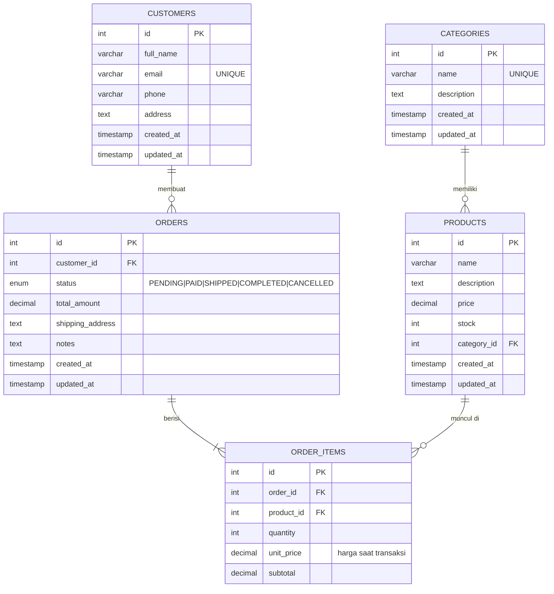

# ERD – E-commerce Management System

## Relasi & aturan referensial

| Relasi | Tipe | Foreign Key | ON DELETE |
|---|---|---|---|
| Category → Products | 1 : N | `products.category_id` | RESTRICT |
| Customer → Orders | 1 : N | `orders.customer_id` | RESTRICT |
| Order → OrderItems | 1 : N | `order_items.order_id` | CASCADE |
| Product → OrderItems | 1 : N | `order_items.product_id` | RESTRICT |

`order_items` adalah tabel penghubung antara `orders` dan `products` (relasi many-to-many dengan atribut tambahan: `quantity`, `unit_price`, `subtotal`).
`unit_price` menyimpan harga produk **pada saat transaksi**, sehingga perubahan harga produk di kemudian hari tidak memengaruhi pesanan lama.
